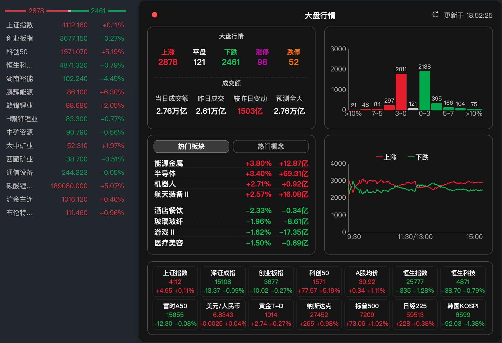

# myStocks


**所有代码纯`AI`驱动, 完全没有牛马味儿**

一个基于 Qt6 的桌面悬浮看盘工具，面向 macOS 与 Windows，适合常驻桌面快速查看自选、指数、板块、港股与期货行情。

## 截图预览



## 项目简介

`myStocks` 强调低打扰、快读取和高可定制。

它不是传统的大而全交易终端，而是一个适合放在桌面边缘、托盘常驻、随时扫一眼市场状态的小工具。你可以把它当作主交易软件之外的第二屏信息层，用更轻的方式盯自选、看热点、看分时、看盘面强弱。

## 功能亮点

- 悬浮窗常驻展示，支持自选股、指数、板块、港股、期货混合监控
- 托盘常驻与全局快捷键，一键显示或隐藏主窗口
- 鼠标悬停分时图弹窗，快速查看日内走势、均价线与刷新状态
- 市场宽度详情弹窗，支持上涨/平盘/下跌、涨停/跌停、成交额和时间线概览
- 热门板块与热门概念展示，方便观察盘中情绪和热点轮动
- 高度可定制的界面配置：列显示、列顺序、列宽、字体、颜色、透明度、置顶、双击隐藏、鼠标穿透
- 网络设置可选择通达信（默认）或东方财富，行情表支持涨速列；通达信 TCP 行情支持 SOCKS5 和 HTTP CONNECT 代理
- 可配置网络行为：`User-Agent`、代理、日志、轮询频率
- 支持检查 GitHub Release 更新并下载当前平台安装包

## 适用场景

- 边工作边盯自选，不想一直停留在交易软件界面
- 通过轻量悬浮窗快速观察盘面强弱、题材热度和市场情绪
- 给主交易终端补一个更适合常驻桌面的辅助信息层

## 平台与技术栈

- macOS
- Windows
- Qt 6
- C++17
- CMake

## 快速开始

### 下载发布版

可直接前往 [GitHub Releases](https://github.com/log2c/myStocks/releases) 下载对应平台的压缩包。

### 本地构建

#### macOS

```bash
brew install cmake qt ninja go
cmake --preset dev-debug
cmake --build --preset dev-debug
```

说明：
如果本机使用 Homebrew 安装 Qt，项目会优先自动探测常见的 Qt6 安装路径。

#### Windows

安装 Qt 6、CMake、Ninja、Go 1.27+ 和 MinGW-w64 GCC（供 cgo 使用）后，执行。Qt/C++ 可继续使用 MSVC，`CC` 应指向 MinGW GCC：

```bash
# PowerShell；按实际安装路径调整
$env:CC = "C:/msys64/mingw64/bin/gcc.exe"
$env:PATH = "C:/msys64/mingw64/bin;" + $env:PATH
cmake -S . -B build -G Ninja -DCMAKE_BUILD_TYPE=Release -DQt6_DIR="你的Qt6_DIR路径"
cmake --build build --parallel
```

### 通达信数据源与更新

构建时通过 CMake 拉取 [bensema/gotdx](https://github.com/bensema/gotdx)，编译项目自带的 Go 桥接层为 `c-shared`，Qt 通过 `QLibrary` 加载其 C ABI。默认拉取 `main`；首次构建需要网络、Go 1.27+ 和 C 编译器。发布版会携带动态库和期货交易日历，使用者无需安装 Go。

在「设置 → 网络 → 行情数据源」切换通达信或东方财富，保存后生效。未配置数据源的旧配置也默认使用通达信。涨速列默认显示，列设置支持隐藏、调整顺序和限制宽度；原有列编号保持兼容。通达信实时行情、详情页指数报价和两处悬停分时均使用同一桥接层。桥接层提供 `klines` 操作返回 OHLC、成交量和成交额，可供后续蜡烛图使用；当前应用本身只有分时图，没有独立的蜡烛图界面。

支持沪深北股票和指数、港股、恒生/恒生科技指数，以及已有自选代码中的大连、上海、郑州和中金所期货；期货主连 `0` 后缀会映射为通达信的 `L8`。搜索结果使用通达信证券目录、板块目录和扩展市场代码。旧的东方财富 `BK` 自选代码会根据名称尝试唯一匹配通达信板块；无法唯一匹配时会明确报错。部分海外指数等没有已验证的通达信映射时，可选择东方财富读取。股票/板块搜索统一使用通达信目录；选用通达信数据源时，热门行业/概念、板块成分、市场涨跌数量、涨停跌停、涨跌分布和量能也使用通达信接口。同花顺独有的人气榜暂时保留原接口。搜索得到的通达信板块和扩展市场代码需要选用通达信数据源；点击添加这类搜索结果时会同步选择通达信，保存设置后生效。

通达信板块及扩展市场使用带来源的代码，例如 `tdx:main:1:881319`（半导体板块）、`tdx:ex:49:02800`（盈富基金），保存到 YAML 后仍保持完整市场标识。首次搜索下载证券/板块/扩展目录，之后缓存 30 分钟。支持代码和名称搜索。市场统计采用 `880001` 全 A 市场的服务端计数与成交额，涨跌分布遍历完整成分；不将指数成交额和个股成交额重复相加。昨日量能比较使用服务器行情日期前一个交易日的全日成交额，增减量按金额显示。涨跌时间线为本次运行中观测到的服务端快照，未请求到的历史点不会补造。

**登录限制：** 当前 gotdx 没有账号密码认证或将用户身份写入 TCP 行情包的接口。设置中的登录入口会标注「待上游支持」并禁用；用户 ID / 会话令牌会传入本地桥接请求，留作后续认证接口使用，当前不会改变服务器端权限，也不会显示为已登录。令牌默认仅保留在本次运行内，主动勾选后才以明文写入本地 `settings.ini`。通达信遵循网络页的代理设置，支持 SOCKS5（含用户名密码认证）和 HTTP CONNECT（含 Basic 认证）；启用代理后，目录、报价、分时、K 线、板块及市场统计的远程连接都通过代理。代理失败会报错，不自动回退直连。HTTP 代理需要允许 CONNECT 到行情服务器的 7709 / 7727 等端口。

更新 gotdx 并重新编译：

```bash
cmake --build build/dev-debug --target update-gotdx
cmake --build --preset dev-debug
```

更新后重启应用加载新动态库。仅需升级依赖时也会重新复制动态库，不依赖 Qt 主程序重新链接。

固定到某个提交或使用本地检出目录：

```bash
cmake --preset dev-debug -DMYSTOCKS_GOTDX_REF=<commit-or-tag>
# 使用本地源码时跳过下载，不提供 update-gotdx 目标
cmake --preset dev-debug -DMYSTOCKS_GOTDX_SOURCE_DIR=/absolute/path/to/gotdx
```

验证桥接市场映射、缺失数据处理及涨速展示：

```bash
cmake --build --preset dev-debug
ctest --preset dev-debug
```

## 配置说明

- 默认自选列表可写在仓库根目录的 `data.yaml`
- 程序也支持从 `~/.myStocks/data.yaml` 读取自选列表
- 首次启动后会生成 `settings.ini` 保存界面与网络配置
- 可在设置窗口中调整热键、外观、列布局、透明度、分时图、市场宽度和代理等选项

示例 `data.yaml`：

```yaml
ver: 1

stocks:
  - code: 1.600519
    name: 贵州茅台
```

## 目录结构

- `include/`：核心头文件，包含配置、数据模型、窗口与类型定义
- `src/`：应用主逻辑实现
- `assets/`：图标与托盘相关静态资源
- `apis/`：接口整理与抓包记录
- `data.yaml`：示例自选列表

## 授权说明

本项目采用仓库内的 [LICENSE](LICENSE) 发布。

你可以在非商业场景下自由使用、学习、修改和分发本项目源码及其衍生版本，但不得将本项目或其衍生版本直接或间接用于商业用途。

补充说明：
严格来说，“禁止商用”不符合 OSI 对开源许可证的定义，因此本项目更准确的表述是“源码公开（source-available）”，而不是传统意义上的“OSI 开源许可证”。

## 鸣谢

- 爱盯盘：产品形态与看盘体验灵感
- 摸鱼看盘：轻量悬浮看盘思路参考
- gotdx / 通达信：默认实时行情、分时和 K 线数据
- 东方财富：可选行情数据源、板块与搜索接口参考来源

本项目与以上产品、服务或品牌均无官方关联。

## 免责声明

- 本项目仅供学习、研究与个人非商业使用
- 行情数据与展示内容不构成任何投资建议
- 因接口变动、网络异常或第三方服务调整导致的问题，项目不承诺持续可用性
