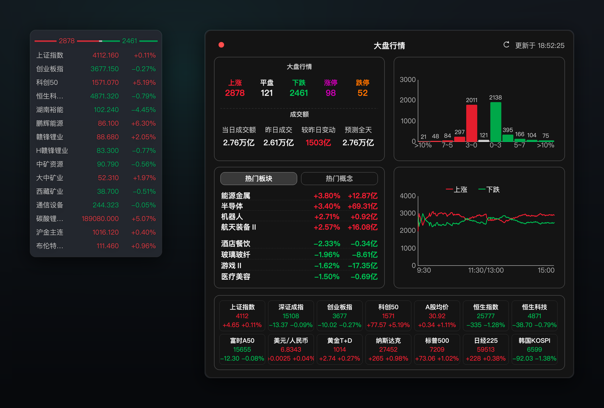

<div align="center">


# myStocks

**常驻桌面的轻量看盘悬浮窗**

<sub>所有代码纯 `AI` 驱动，完全没有牛马味儿</sub>


</div>



> 截图取自开发中的版本，实际界面会随版本与本地配置略有差异。

[项目简介](#项目简介) · [功能特性](#功能特性) · [快速开始](#快速开始) · [数据源与网络](#数据源与网络) · [配置说明](#配置说明) · [鸣谢](#鸣谢)

## 项目简介

`myStocks` 强调低打扰、快读取和高可定制。

它不是传统的大而全交易终端，而是一个适合放在桌面边缘、托盘常驻、随时扫一眼市场状态的小工具。你可以把它当作主交易软件之外的第二屏信息层，用更轻的方式盯自选、看热点、看分时、看盘面强弱。

界面基于 Qt 6 绘制，行情由项目自带的 Go 桥接层通过通达信协议直接读取，不依赖浏览器、Electron 或任何第三方行情客户端。

## 功能特性

### 行情与自选

- 自选股、常用指数、板块、港股、期货混排监控，支持分组与 `前缀 + F1..F10` 快捷切换
- 推送与快照双通道：价格按轮询间隔由推送通道刷新，名称、涨速、开盘前状态由低频完整快照补齐
- 列可自由组合：代码、名称、价格、涨跌幅、涨跌额、指标箭头（按涨跌强度显示 1–3 档 ▲/▼）、成本、成本涨跌幅、盈亏平衡增益、涨速
- 开盘集合竞价（09:15–09:25）单独识别，不会与休市混淆
- 成本价相关列可直接盯持仓浮盈与回本点位

### 图表

- 鼠标悬停即出分时图：价格线、均价线、成交量、高/低标注
- 按住 `Ctrl` 在分时图上切换日 K：蜡烛、MA5/10/20/30/60/120/250、成交量、跳空缺口、可视区间统计
- 日 K 支持拖动平移与滚轮缩放，行情刷新不会打断已经调整过的视图
- 大盘行情窗口：涨跌家数、涨跌分布直方图、成交额对比、涨跌时间线、热门板块/概念、涨停/跌停池、常用指数网格

### 交互与外观

- 托盘常驻 + 全局热键，一键显示或隐藏悬浮窗
- 全局右键关闭任意窗口、双击股票看 K 线、鼠标穿透
- 列显隐/顺序/宽度、字体、配色、透明度、置顶、窗口内边距全部可调
- 简洁模式、闪烁提醒、托盘悬浮信息、鼠标悬浮阅读增强
- 界面支持简体中文 / 英文，默认跟随系统

### 数据与网络

- 通达信实时行情，主行情与扩展行情各一条线路，独立地址池、延迟测速、故障自动切换
- 支持 SOCKS5 与 HTTP CONNECT 代理，也可指定网卡发起请求（两者互斥）
- `User-Agent` 支持内置 Chrome/Safari 随机预设或自定义，并提供请求日志
- 同花顺提供涨跌分布聚合、涨停/跌停池与个股人气榜
- 自选配置可通过 GitHub Gist 多设备同步，带冲突检测
- 启动时检查 GitHub Release 更新，支持 gh-proxy 国内加速下载

## 适用场景

- 边工作边盯自选，不想一直停留在交易软件界面
- 通过轻量悬浮窗快速观察盘面强弱、题材热度和市场情绪
- 给主交易终端补一个更适合常驻桌面的辅助信息层

## 平台与技术栈

- **平台**：macOS、Windows
- **界面**：Qt 6 / C++17
- **构建**：CMake + Ninja
- **行情桥接**：Go（cgo 编译为 `c-shared`，Qt 通过 `QLibrary` 加载 C ABI）

## 快速开始

### 下载发布版

前往 [GitHub Releases](https://github.com/log2c/myStocks/releases) 下载对应平台的压缩包：

- `MyStocks-macos-release-<tag>.zip`
- `MyStocks-windows-release-<tag>.zip`

发布版已携带行情桥接动态库与期货交易日历，无需安装 Go。

### 本地构建

#### macOS

```bash
brew install cmake qt ninja go
cmake --preset dev-debug
cmake --build --preset dev-debug
```

如果本机使用 Homebrew 安装 Qt，项目会优先自动探测常见的 Qt6 安装路径。

#### Windows

安装 MSVC、Qt 6 的 MSVC 版本、CMake、Ninja、Go 1.27+ 和 MinGW-w64 GCC（供 cgo 使用）后，在已初始化 MSVC x64 环境的终端中执行。CMake 的 C++ 编译器显式指定为 `cl`，`CC` 单独指向 MinGW GCC，避免加入 MinGW PATH 后自动选中不兼容的 C++ 工具链：

```powershell
# 按实际安装路径调整
$env:CC = "C:/msys64/mingw64/bin/gcc.exe"
$env:PATH = "C:/msys64/mingw64/bin;" + $env:PATH
cmake -S . -B build -G Ninja -DCMAKE_BUILD_TYPE=Release -DCMAKE_CXX_COMPILER=cl -DQt6_DIR="你的Qt6_DIR路径"
cmake --build build --parallel
```

`C:/msys64` 仅为本地安装路径示例；应确认 `$env:CC` 指向的 `gcc.exe` 存在且能运行。GitHub Actions 使用 `msys2/setup-msys2` 的 `msys2-location` 输出定位 GCC，并从同一安装目录复制 cgo 所需的运行库，不依赖固定盘符或目录。

### 更新桥接依赖

构建时通过 CMake 拉取 [bensema/gotdx](https://github.com/bensema/gotdx)，编译项目自带的 Go 桥接层。默认拉取 `main`；首次构建需要网络、Go 1.27+ 和 C 编译器。

```bash
# 更新 gotdx 后重新编译（无需重新链接 Qt 主程序）
cmake --build build/dev-debug --target update-gotdx
cmake --build --preset dev-debug
```

更新后重启应用加载新动态库。固定到某个提交，或改用本地检出目录：

```bash
cmake --preset dev-debug -DMYSTOCKS_GOTDX_REF=<commit-or-tag>
# 使用本地源码时跳过下载，不提供 update-gotdx 目标
cmake --preset dev-debug -DMYSTOCKS_GOTDX_SOURCE_DIR=/absolute/path/to/gotdx
```

### 测试

```bash
cmake --build --preset dev-debug
ctest --preset dev-debug
```

覆盖行情模型、K 线视图、分时量能、涨停池、配置迁移、网络接口、启动流程与更新检查。

## 数据源与网络

### 行情数据源

目前只提供通达信。旧配置里的东方财富选择会回到通达信；已有个股、ETF 和指数代码（例如 `1.600519`、`116.00700`、`1.510300`、`1.000001`）继续交给通达信读取，只跳过 `BK` 等没有明确映射的代码。未支持的条目保留在原文件中，保存自选和分组修改时不会删除。

代码格式兼容 `1.600519` 与 `tdx:main:1:600519`；板块与扩展市场使用带来源的代码（如 `tdx:main:1:881319`、`tdx:ex:49:02800`），保存到 YAML 后仍保持完整市场标识。首次搜索会下载证券、板块和扩展目录，之后缓存 30 分钟。

### 线路与推送

- 主行情与扩展行情各自维护地址池，默认自动选择 TCP 延迟最低且协议可用的节点
- 每组线路有独立连接通道，目录、报价、分时、K 线互不排队
- 报价优先走推送通道，完整快照按「元数据刷新间隔」补齐；推送覆盖不全时自动回落到快照间隔
- 自动模式遇到传输失败会暂时避开故障节点 60 秒，重新测速并重试一次；手动模式固定使用选中节点

### 图表数据

分时弹窗、日 K 与大盘行情都走同一桥接层。显示范围在「设置 → 显示 → 分时图 → 日K显示范围」配置，默认最近 60 个交易日，可设 1–800 个交易日；历史不足时显示可用数据。日 K 使用不复权价格，刷新间隔在「日K刷新间隔」中配置，默认 2 秒。

日 K 均线在「设置 → 显示 → 分时图 → 日K均线」分别勾选，默认显示 MA5/10/20/30，配色依次为白、黄、紫、绿、青、蓝、橙。计算均线会额外读取所需历史，不改变显示天数，历史不足的点不补造。高低价只画箭头和价格标记，统计范围为当前可视 K 线；跳空缺口以涨跌色淡色区域标记，仅显示可视范围内形成且尚未回补的部分。

### 市场宽度与涨跌分布

市场涨跌家数采用 `880001` 全 A 市场服务端计数；涨跌分布优先读取同花顺的聚合结果（约 140 ms / 0.5 KB），校验失败时回退到遍历通达信完整成分的老路径（约 3 s / 1.4 MB）。两种来源使用同一套 ±10% 分档标签，回退不会改变图形语义。「大盘行情」的成交额与昨日比较使用同花顺 `turnover_minute` 接口，涨跌时间线为本次运行中观测到的服务端快照，未请求到的历史点不会补造。

### 代理与网卡

「设置 → 网络 → 网络接口 / 网卡」默认「自动（系统路由）」，也可以指定网卡。保存后启动和重新加载的线路检测、行情、分时、同步、更新等请求均通过所选网卡发起。HTTP/HTTPS 流量经本地认证 SOCKS5 转发器绑定网卡，TLS 仍由 Qt 处理。

启用远端代理时，连接代理也绑定该网卡；网卡与代理互斥，只能启用其中一种。已拔出或未连接的已选网卡会保留选择并报连接错误，不自动回退系统默认网卡。

### 服务器节点

「设置 → 通达信」分别管理主行情和扩展行情地址池，认证字段集中在「登陆」分组。可测试所选节点、测速整个地址池、添加或删除 `主机:端口`，以及恢复 SDK 默认池。点击「切换到所选节点」进入该组手动模式，点击「确定」后生效，取消设置不改变当前连接。测速遵循「网络」页的代理设置。

### 启动与重新加载

如果悬浮窗已经显示，splash 覆盖在悬浮窗位置并保持上层；悬浮窗隐藏时，splash 位于主屏可用区域的右下角。先读取线路与代理所需的少量设置，依次检测主行情和扩展行情的 TCP 延迟，再验证通达信行情协议，两组线路确认后才加载完整配置、自选和分组。全部检测失败时可重新检测或离线加载本地配置，离线状态通过重新加载恢复。

### 登录限制

当前 gotdx 没有账号密码认证或将用户身份写入 TCP 行情包的接口。设置中的登录入口会标注「待上游支持」并禁用；用户 ID / 会话令牌会传入本地桥接请求，留作后续认证接口使用，当前不会改变服务器端权限，也不会显示为已登录。令牌默认仅保留在本次运行内，主动勾选后才以明文写入本地 `settings.ini`。

## 配置说明

- 默认自选列表可写在仓库根目录的 `data.yaml`
- 程序也支持从 `~/.myStocks/data.yaml` 读取自选列表
- 首次启动后会生成 `settings.ini` 保存界面、网络与数据源配置
- 可在设置窗口中调整热键、外观、列布局、透明度、分时图、市场宽度、代理和 Gist 同步

示例 `data.yaml`：

```yaml
ver: 1

stocks:
  - code: 1.600519
    name: 贵州茅台
```

### 常用操作

| 操作 | 方式 |
| --- | --- |
| 显示 / 隐藏悬浮窗 | 「设置 → 通用 → 快捷键」自定义全局热键 |
| 打开大盘行情 | 同上，单独设置热键 |
| 切换分组 | 设置前缀（如 `Ctrl+Shift`）后按 `F1`–`F10` |
| 查看分时图 | 鼠标停留在股票行首列，默认 500 ms 后弹出 |
| 查看日 K | 在分时图上按住 `Ctrl`，松开恢复分时 |
| 关闭任意窗口 | 右键单击 |
| 查看个股 K 线 | 双击股票行 |

## 目录结构

- `include/`：核心头文件，包含配置、数据模型、窗口与类型定义
- `src/`：应用主逻辑实现
- `bridge/`：Go 行情桥接层，封装通达信协议并导出 C ABI
- `cmake/`：构建辅助脚本，负责拉取 / 更新 gotdx 与打包元信息
- `assets/`：应用图标与托盘静态资源
- `tests/`：单元测试
- `docs/`：截图与文档

## 授权说明

本项目采用仓库内的 [LICENSE](LICENSE) 发布。

你可以在非商业场景下自由使用、学习、修改和分发本项目源码及其衍生版本，但不得将本项目或其衍生版本直接或间接用于商业用途。

严格来说，「禁止商用」不符合 OSI 对开源许可证的定义，因此本项目更准确的表述是「源码公开（source-available）」，而不是传统意义上的「OSI 开源许可证」。

## 鸣谢

- **爱盯盘**：产品形态与看盘体验的灵感来源
- **摸鱼看盘**：轻量悬浮看盘的思路参考
- **[bensema/gotdx](https://github.com/bensema/gotdx)**：通达信行情协议的 Go 实现，本项目的桥接层构建在它之上
- **通达信**：实时行情、分时、K 线、板块与扩展市场数据
- **同花顺**：涨跌分布聚合、涨停/跌停池与个股人气榜
- **东方财富**：早期版本的行情来源与接口调研参考
- **Qt**：跨平台界面框架
- 托盘图标素材来自网络公开图标集，版权归原作者所有
- 以及一路参与开发、审查与调试的 AI 编程助手们

本项目与以上产品、服务或品牌均无官方关联。

## 免责声明

- 本项目仅供学习、研究与个人非商业使用
- 行情数据与展示内容不构成任何投资建议
- 因接口变动、网络异常或第三方服务调整导致的问题，项目不承诺持续可用性
